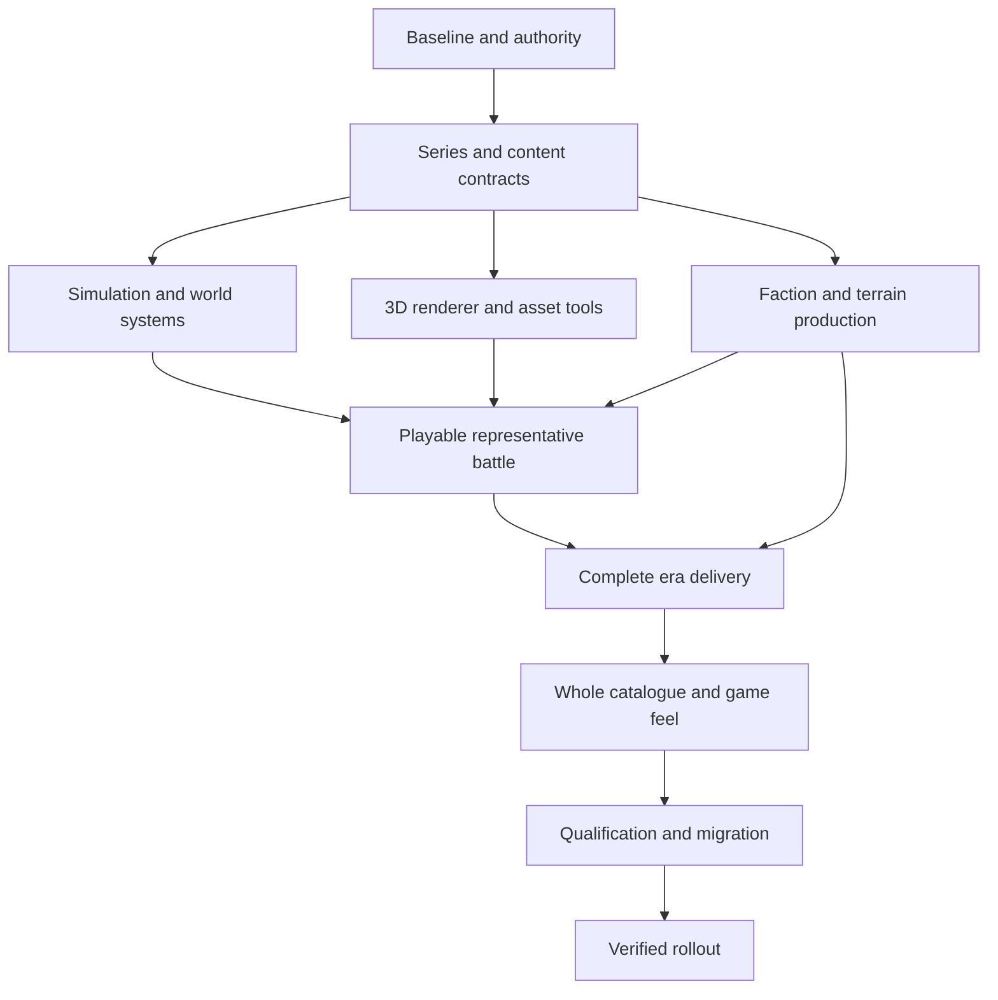

# Project COMRADE Fusion 3D implementation programme

**Owner:** Andrew Taylor. **Mandate:** 18 November 2026. **Programme epic:** [THU-2533](https://linear.app/thunderchild-creative/issue/THU-2533/comrade-f3d-upgrade-fusion-to-the-complete-3d-series-homage). **Inspected code:** [main 84f411478f01ed62365a2e4d1d316eb57d9e193c](https://github.com/Flatt-T/ProjectComrade/tree/84f411478f01ed62365a2e4d1d316eb57d9e193c).

Upgrade Fusion to a genuine 3D, fully animated, series-wide Command & Conquer homage. Deliver complete faction buildings and units, meaningful variants and abilities, comprehensive terrains, destructible and rebuildable bridges, and gameplay that preserves faction identity and tactical character. Preserve the separately contracted Classic experience and existing persistent-world state and protections. This is a complete staged programme, not a promise that a small vertical slice satisfies the whole request.

## Research results available to the fleet

Open the [source-indexed research register](research/results-2026-11-18/README.md) for the playable baselines, original 3D studies, map evidence, edition comparisons and each research issue’s actual results. The [cross-title lookup](research/results-2026-11-18/catalogue/README.md) gives a specialist one source record and its owning work order. The [Linear register](https://linear.app/thunderchild-creative/document/comrade-22-fusion-series-research-results-and-evidence-register-b28ae692c863) contains the native reports and complete downloadable deposit.

## Start the fleet

1. Read this entry point, the [scope and authority](programme/01-authority-and-scope.md), [fleet contract](programme/02-fleet-execution.md), [verified audit](engine/01-engine-baseline-and-gap-audit.md), [architecture](engine/02-fusion-3d-architecture-and-contracts.md) and [existing work crosswalk](programme/05-existing-work-crosswalk.md).
2. Load `tasks.json`, `task-index.md` and the real IDs in `linear-publication.json`. Read the selected task's full `tasks/<ID>.md`, required source documents and current owning Linear issue, including later amendments/comments. Do not replace this packet with a short title.
3. Reconcile current main/runtime state, preserve work in progress, validate the task graph and dispatch only ready tasks. The coordinator allocates specialists and file leases; each independent reviewer checks evidence before the integrator accepts the change.
4. Continue through research, contracts, live 3D and world systems, representative battle, all era/faction/entity production, whole-catalogue experience, qualification and rollout. Refresh dependencies and handoffs after every accepted change. Complete unblocked work while a specific input is blocked.

The final planning documents are versioned on the documentation PR linked from the epic. Read that branch if they are not yet on main. Base implementation branches on refreshed repository state; do not merge or deploy a documentation branch as though it contains the new engine.

## What this audit found

Fusion already has a substantial deterministic simulation, lockstep play and persistent-world infrastructure. Its current presentation is Canvas2D with baked procedural sprites. It needs a real GPU scene, complete rigs and animation, and an explicit read-only presentation boundary. The map requires authoritative elevation and multiple surfaces so bridges, ships, ramps, aircraft and movement domains behave coherently. Existing pack approximations and balance extensions must become visible source-to-Fusion decisions.

Current composed definitions total 535 units and 481 structures, including aliases and generated service variants. They are a preservation baseline, not an exhaustive C&C census or a count of unique finished models. The source audit also identifies native Classic multiplayer order propagation and placeholder test commands as separate verification gaps. Details and precise source references are in the audit; no live release certification is implied by this planning pack.

## Initial work orders

The checked graph contains **138 initial work orders**: 29 research, 46 engine, 20 art/animation, 11 world/terrain, 8 experience/UI/audio, 12 programme/integration and 12 era delivery gates. These are not the final count of individual production leaves. The canonical generator must add bounded tasks for every accepted source entity, form, capability, animation part, faction integration and terrain kit. All mandatory initial tasks reach INT-005; candidate documentation INT-006 is an explicit prerequisite to closing rollout.

Run `python docs/fusion-3d/validate_plan.py` to check schema, dependencies, final ancestry and the real Linear publication map. This validates planning structure, not a finished game.

## Programme map

The graph shows coordination, not a mandate to idle specialists. Research, original concept work and independent test design proceed in parallel. Generated content tasks begin when their own source, capability and asset contracts are accepted; they need not wait for unrelated eras. Final gates still require complete mandatory coverage.

## Document index

| Document | Read for |
| --- | --- |
| [Authority and scope](programme/01-authority-and-scope.md) | Owner mandate, profile boundaries, all-era scope, preserved rules and distribution decisions |
| [Fleet execution](programme/02-fleet-execution.md) | Roles, task packets, file ownership, dispatch, independent review and context handoff |
| [Quality and release](programme/03-quality-and-release.md) | G0–G8 gates, player journeys, visual review, device measurements and migration/rollout |
| [Content work orders](programme/04-content-work-order-contract.md) | Deterministic expansion into bounded faction/entity/model/animation/FX/test tasks |
| [Existing work crosswalk](programme/05-existing-work-crosswalk.md) | Continuing owners, verified code facts and historical evidence limits |
| [Engine audit](engine/01-engine-baseline-and-gap-audit.md) | Exact current source, counts, architecture gaps and unverified claims |
| [Engine architecture](engine/02-fusion-3d-architecture-and-contracts.md) | Renderer boundary, surfaces, navigation, bridges, capabilities, replay/protocol and migration |
| [Series research](research/01_series_research_and_fidelity.md) | All title families, factions, mechanics, terrain, source hierarchy and fidelity distinctions |
| [Catalogue schema](research/02_catalogue_schema_and_completion.md) | Complete source inventory, per-entity semantics and evidence/closure rules |
| [Source register](research/source_register.md) | Primary manuals/source releases, verified access and limitations |
| [Era/faction matrix](research/era_faction_matrix.json) | Explicit groups, expansions, special/campaign objects and scope dispositions |
| [Art and animation](world-art/01_art_and_animation_contract.md) | Full 3D asset grammar, class animation/state matrices, pipeline, LOD and complete production |
| [Terrain and bridges](world-art/02_terrain_and_bridges_contract.md) | Environment kits, topology, transition rules and precise Fusion bridge defaults |
| [Experience, audio and quality](world-art/03_experience_audio_and_quality_gates.md) | Camera/UI/mobile/audio/accessibility, reference battles and measured quality |
| [Independent programme review](programme/06-independent-review.md) | Planning contradictions, their corrections and final graph findings |
| [Gameplay coverage review](programme/07-gameplay-coverage-review.md) | Objective lifecycle and shared capability ownership checks |
| [Per-entity work orders](world-art/04_per_entity_work_orders.md) | Full specification, simulation, model, rig, animation, effects, integration and review instructions |
| [Task index](task-index.md) | Every immediately specified task, specialist and dependency |
| [Machine-readable tasks](tasks.json) | Coordinator input and deterministic dependency validation |
| [Planning and publication verification](publication-verification.json) | Independent readback of all 138 native tasks and 566 prerequisites, with complete packet checks |
| [Publication map](linear-publication.json) | Actual Linear issue/document IDs and URLs |

The specialist directories also contain their task registers and machine-readable source inventories. Raw source candidates and XML file paths are discovery inputs, not certified playable counts. They retain exact revisions so researchers can resolve inheritance, buildability, campaign availability and variants reproducibly.

## Full production rule

Read the finite research/system tasks first. After each title census is independently accepted, generate real bounded production children for every required faction/entity/form/state and terrain kit using the content work-order contract. Parent era delivery gates cannot close until every generated child and its complete evidence pass. No worker may mark a whole era complete because the first two armies are attractive or the definition loader accepts its IDs.

## Evidence and unresolved inputs

All external facts and current-code claims have sources in the audit or source register. The linked YouTube video is a required inspiration/evidence item, but its full footage/transcript was not accessible during this planning run. The video task records the gap and requires timestamped observations when access is available; this pack does not invent what the narrator said. Primary series research and independent engineering continue meanwhile.

No AI prompt guarantees absolute accuracy. This programme makes mistakes detectable through bounded scope, source pins, explicit interfaces, independent review, deterministic tests, actual play and complete coverage reconciliation. A blocked source or failed criterion stays visible, with a next action, until resolved.

## Copyable starter

Act as the coordinator for COMRADE Fusion 3D epic THU-2533. Read this full entry point and its required contracts, the documentation PR, all linked task details and current GitHub/Linear state. Preserve Classic, saved worlds and accepted persistent rules. Validate the dependency graph, then dispatch one bounded task per specialist context with exclusive file ownership and independent review. Work through G0–G8 and generate the mandatory per-faction/per-entity/terrain production children from accepted censuses. Continue until the complete programme is evidenced; a renderer demo or representative battle is only an intermediate gate. Never invent source facts, skip missing animations or silently reduce scope. Record exact revisions, tests, captures, blockers and recoverable handoffs, and use the existing conditional release authority only after its gates pass.
