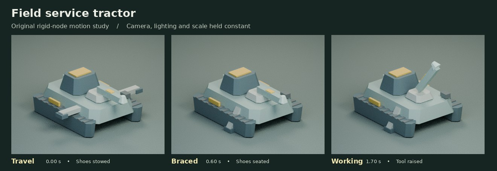
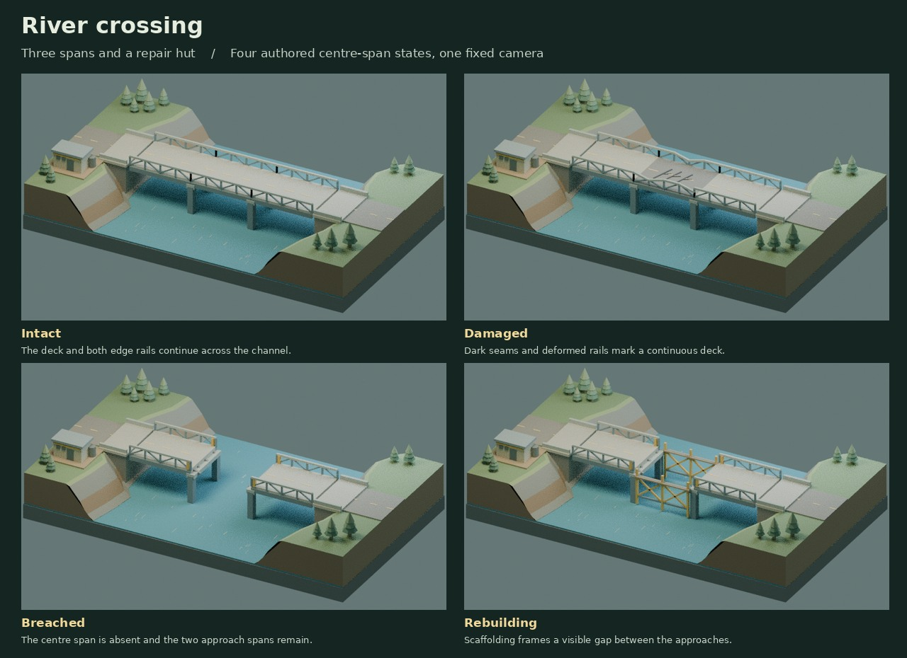

# Visual, animation and landscape evidence

Start with [era and faction art direction](visual-direction.md), [the landscape field guide](terrain-field-guide.md) and [motion and acceptance](motion-and-acceptance.md). Every colour, shape, timing or budget labelled as a Fusion proposal is an authored decision. Fields credited to a game data declaration have a release and source locator. The independent [documentary tile review](documentary-readback.md) records four frame-level observations.



## A working, original 3D motion study

[Self-contained glTF 2.0](field-service-tractor.gltf) · [5.5-second movement preview](service-cycle.webp) · [Blender measurements](fixture-verification.json) · [Chromium WebGL2 measurements](webgl-verification.json) · [Independent OpenGL measurements](gpu-verification.json).

The metre-authored tractor is an original research blockout. Six moving nodes control the bracing legs and service boom. For the inspection camera, travel, braced and elevated service poses are different silhouettes. The GL model contains 46 nodes, 37 mesh instances, 17 unique meshes, 284 unique or 540 instantiated triangles. The technical model has rigid joint animation, local geometry and material colours. It has no combat role, shipped predecessor identity, runtime integration, authored LOD chain or physical-device approval.

| Observation | Method and result |
|---|---|
| Motion is present in a standard glTF importer | Blender 4.3.2 sampled five poses. Both closed shoes sit 11.369 mm above the plane when braced. Tool-tip height rises 1.15689 m. Root remained fixed at all sampled poses, and retract returned to the original tool position. |
| Motion produces visible pixel changes in WebGL2 | Headless Chromium 141.0.7390.0, ANGLE/SwiftShader, Three r180, 224 × 160 offscreen framebuffer. 4,688 actor pixels. Travel→brace changed 367 pixels, brace→work 596, work→scan 420, travel→returned 0. A camera ray encountered the cab first and intersected three distinct meshes. |
| Independent sampler and raster output agree with a complete cycle | The same glTF loaded under Node/Three r180. Mesa 25.0.7 llvmpipe via EGL/OpenGL 4.5 drew the five postures. Corresponding pixel counts were 4,687, 369, 597, 422 and 0. The ray again hit the cab first. |
| Artist review export | CPU Cycles produced 66 source samples at 12 fps. WebP merged one equal consecutive sample, preserving the full 5.5-second display duration in 65 encoded frames. Browser/mobile game framerate and touch latency require separate measurements on physical hardware. |

The soft pale body and hard ochre roof panel on the fixture expose articulation against a fixed matte ground. It is intentionally an isolated pose test. Production art still needs its own final silhouette and material approval under the game’s terrain, lighting, ownership markings, normal zoom and device settings.

## A modular 3D bridge and river landscape



[Original four-scene glTF](bridge-study.gltf) · [WebGL2 ray and framebuffer measurements](bridge-study-verification.json). An original three-span deck crosses a channel between terraced banks. The neutral repair hut and two approach spans stay visible across all four states. In headless Chromium, a ray down the centreline hit a deck at 3.09 m in intact/damaged states, and water at −0.21 m in breached/rebuilding states. At 320 × 200, the damaged, breached and rebuilding scenes changed 1,051, 1,431 and 1,814 pixels respectively against the intact view. Visual ray hits expose a stray deck or scaffold surface in a fixture. The live path graph, occupant protection, engineer admission, topology changes and repair refund are separately exercised by the gameplay and transaction contracts.

Every scene contains separate transform nodes for the static site while sharing the common mesh data. This permits switching scenes in ordinary glTF loaders. The reference is a static proposal for the visual stages; the authority owns when a stage changes and the later production rig must supply continuous destruction and rebuild motion.

## Source indexes

| Data | Scope |
|---|---|
| [Classic motion records](classic-motion-evidence.json) | 46 infantry declarations, 33 action-table families and 953 action rows. Includes zero-length and explicitly unavailable actions. |
| [Classic terrain templates](classic-terrain-templates.tsv), [classic terrain props](classic-terrain-props.tsv), [source locators and counts](classic-terrain-summary.json) | 619 template declarations and 67 prop declarations. Includes title-local theatre membership, occupied/overlap cells, conditional declarations and applicable source-only dimensions/land or interaction fields. |
| [Tiberium Wars scenery](sage-scenery-tw.tsv), [Kane’s Wrath](sage-scenery-kw.tsv), [Red Alert 3](sage-scenery-ra3.tsv), [Uprising](sage-scenery-uprising.tsv), [Tiberian Twilight](sage-scenery-c4.tsv) | 10,863 strict local GameObject declarations. Distinct branch/folder paths and source blobs retained. Blank local fields may inherit. Includes test/placeholder/editor assets. |
| [SAGE terrain materials](sage-terrain-materials.tsv), [map records](sage-map-index.tsv), [collection summary](sage-environment-summary.json) | 1,469 texture/material references and 524 leaf map-metadata rows, including two sparse TW entries without filenames. The two immutably identified malformed boat source files are described in the summary, separately from all parseable entities. |
| [Source-backed visual studies](visual-direction.md), [28 landscape briefs](terrain-field-guide.md), [motion production and acceptance](motion-and-acceptance.md) | Named faction and object studies, tile/prop interpretation, regional subkits, 3D/sprite roles, animation timing, interrupt logic, review shots, physical-device acceptance, evidence distinctions and specialist handoffs. |

For a later scenery row, reconstruct the URL as `https://github.com/electronicarts/CnC_Modding_Support/blob/3aad8e412961ab543192ae70f8503dc8e178e095/{branch}/Xml/Civilian/{path}`, URL-encoding path segments. Branch names are the exact EA archive directories “Tiberium Wars”, “Kanes Wrath”, “Red Alert 3”, “Uprising”, “Tiberian Twilight”. The git_blob is the hash of the original file bytes; the identifiers are references for research. A local render-state declaration does not prove that the retail campaign instanced it. Join gameplay admission, immutable map observations, inheritance and production menu research separately. [EA archive](https://github.com/electronicarts/CnC_Modding_Support/tree/3aad8e412961ab543192ae70f8503dc8e178e095)

## Reproduce

Run in this directory with Python 3 and the named source files checked out at the commits in the summaries. Generated result paths below can be an empty temporary directory. The motion fixture builder writes the original glTF alongside its script. The package requires no downloaded game art.

```sh
python extract_classic_motion.py TD/IDATA.CPP RA/CODE/IDATA.CPP out/classic-motion-evidence.json
python extract_classic_terrain.py TD/CDATA.CPP TD/TDATA.CPP RA/CODE/CDATA.CPP RA/CODE/TDATA.CPP out
python extract_sage_environment.py CnC_Modding_Support-3aad8e412961ab543192ae70f8503dc8e178e095.zip out
python build_motion_fixture.py
blender -b -t 2 -P render_motion_fixture.py -- out/renders --preview
python assemble_motion_previews.py out/renders out
```

`assemble_motion_previews.py` uses Pillow with WebP animation support and DejaVu Sans. The render script was exercised using Blender 4.3.2. For the browser ray/pixel check, install `three@0.180.0` in an isolated npm directory, install Python Playwright, and provide a working desktop Chromium or Chromium headless-shell binary. The recorded run used the headless-shell supplied by `@sparticuz/chromium@141.0.0`. For the independent native raster check use Node, Python ModernGL 5.12.0 and an EGL driver. These tools are research-only dependencies.

```sh
python check_webgl_fixture.py /path/to/node_modules/three out/webgl-verification.json --chromium /path/to/chromium
python check_gpu_fixture.py /path/to/node_modules/three out/gpu-verification.json
```

For the bridge, use Blender to create the original glTF and four stills, then assemble the comparison sheet. The validation script reads the glTF adjacent to itself; place a regenerated copy at that location before running the browser fixture.
    
```sh
blender -b -t 4 -P build_bridge_study.py -- out/bridge
python assemble_bridge_preview.py out/bridge out/bridge-state-board.jpg
python check_webgl_fixture.py /path/to/node_modules/three out/bridge-study-verification.json --chromium /path/to/chromium --bridge
```

Neither script returns a frame-pacing benchmark. The event and physical device matrix in [motion and acceptance](motion-and-acceptance.md) defines the required evidence for shipping.
